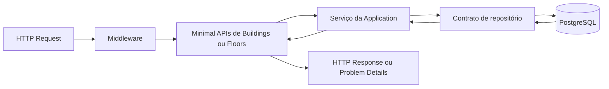

# Camada API

## Propósito

`SmartBuilding.Api` é a borda HTTP e o processo executável da aplicação. Ela recebe requests, valida o contrato de transporte, chama casos de uso e transforma resultados em respostas HTTP.

A API também é o composition root: o local onde abstrações são conectadas às implementações concretas.

## Estado atual

A API contém:

- host ASP.NET Core em .NET 10;
- geração do documento OpenAPI em ambiente de desenvolvimento;
- redirecionamento HTTPS;
- endpoint `GET /` para indicar que o processo está ativo;
- grupo de Minimal APIs em `/api/buildings` com listagem, consulta por ID, criação, substituição e remoção;
- grupo de Minimal APIs em `/api/floors` com as mesmas cinco operações CRUD;
- grupo de Minimal APIs em `/api/access-points` com as mesmas cinco operações CRUD;
- grupo de Minimal APIs em `/api/users` com as mesmas cinco operações CRUD;
- grupo de Minimal APIs em `/api/cards` para listar, consultar, emitir, substituir e ativar/desativar cartões;
- grupo de Minimal APIs em `/api/permissions` para listar, consultar, criar, substituir e remover permissões;
- grupo de Minimal APIs em `/api/access` para processar pedidos e consultar `AccessEvent`s;
- endpoint anónimo `POST /api/auth/login` que valida credenciais e emite JWT Bearer;
- autenticação de tokens JWT (esquema HTTP Bearer) e policies `AdminOnly`/`AccessOperations` aplicadas no servidor;
- CRUD administrativo protegido por `Admin` e operações de Access Control permitidas a `Admin` ou `SecurityOperator`;
- contratos HTTP próprios para requests e responses de `Building`, `Floor`, `AccessPoint`, `User`, `AccessCard` e `AccessPermission`;
- validação automática com DataAnnotations e `AddValidation`;
- validação de email de User que ignora whitespace externo ao verificar o formato;
- Problem Details para validação, conflitos e falhas inesperadas;
- referências para Application e Infrastructure;
- leitura obrigatória de `ConnectionStrings:SmartBuilding`;
- registro de Application por `AddApplication`;
- registro da persistência por `AddInfrastructure`;
- aplicação de migrations e seed apenas em `Development`.

Ainda não contém:

- atualização de `OccupancySession`, processamento de alertas ou notificações SignalR;
- Swagger UI interativo;
- health checks completos.

## Dependências

### Permitidas

- `SmartBuilding.Application` para executar casos de uso;
- `SmartBuilding.Infrastructure` para registrar implementações;
- ASP.NET Core e bibliotecas relacionadas ao transporte;
- configuração, logging, autenticação e observabilidade.

### Proibidas como responsabilidade

- implementar regras de concessão de acesso em endpoints;
- consultar `DbContext` diretamente em cada endpoint como padrão arquitetural;
- retornar entidades persistidas diretamente;
- guardar secrets no código ou em ficheiros versionados;
- considerar guards do frontend como autorização suficiente.

## Bootstrap atual

`Program.cs` executa estes passos:

```text
1. cria WebApplicationBuilder;
2. lê e valida ConnectionStrings:SmartBuilding;
3. registra OpenAPI, validação, Problem Details, Application e Infrastructure;
4. lê e valida a configuração JWT e registra autenticação e policies;
5. constrói a aplicação;
6. em Development, publica OpenAPI e inicializa o banco com migrations;
7. garante o bootstrap do primeiro Admin se ainda não houver um;
8. configura middleware de autenticação/autorização e endpoints.
```

Se a connection string estiver ausente ou vazia, a API falha imediatamente com `InvalidOperationException`. Isso evita iniciar um processo parcialmente configurado. User Secrets está habilitado para desenvolvimento local e nenhum segredo foi versionado.

Em `Development`, `InitializeDevelopmentDatabaseAsync` executa migrations e o seed mínimo antes de a aplicação começar a servir requests. Nos demais ambientes, essa inicialização automática não ocorre.

O endpoint atual responde aproximadamente:

```json
{
  "name": "Smart Building API",
  "status": "Running"
}
```

Isoladamente, esse endpoint confirma apenas que o host iniciou. Na validação realizada em `Development`, o arranque anterior ao request também aplicou a migration e o seed com sucesso num PostgreSQL real.

## Fluxos implementados para Buildings e Floors



Os endpoints são finos: mapeiam requests para commands, chamam `IBuildingService` ou `IFloorService` e convertem os DTOs da Application em responses HTTP. Eles não usam `DbContext` diretamente.

## Access Control: pedido e eventos

O grupo `/api/access` expõe o caso de uso de decisão e a auditoria:

| Método e rota | Resultado | Outros resultados |
|---|---|---|
| `POST /api/access/requests` | `200 OK` com `AccessEventResponse` para decisão processada, concedida ou negada | `400 Bad Request` com RFC `ValidationProblemDetails` para request inválido; `404 Not Found` com Problem Details se o `AccessPointId` não existe |
| `GET /api/access/events` | `200 OK` com todos os eventos, mais recentes primeiro | — |
| `GET /api/access/events/{id}` | `200 OK` com o evento | `404 Not Found` se o evento não existe |

O POST recebe `cardNumber`, `accessPointId` e `direction`. O número deve conter
caractere não branco e ter no máximo 100 caracteres; o ID não pode ser vazio e
`direction` deve ser um valor de `AccessDirection`. Falhas de DataAnnotations
ou validação da Application são representadas como erros de validação RFC 7807
(`application/problem+json`), não como decisões negadas. Um cartão inexistente,
inativo ou expirado é uma decisão de negócio e retorna `200` com um
`AccessEvent`, não um erro HTTP.

`GET /api/access/events` ainda não tem paginação nem filtros: retorna a lista
completa ordenada por `OccurredAt` decrescente (com ID como desempate).

Exemplo de decisão negada para cartão desconhecido:

```json
{
  "id": "00000000-0000-0000-0000-000000000101",
  "accessPointId": "30000000-0000-0000-0000-000000000001",
  "accessCardId": null,
  "userId": null,
  "occurredAt": "2026-10-20T17:00:00Z",
  "direction": "Entry",
  "result": "CardNotFound",
  "reason": "Access card was not found."
}
```

Para um AccessPoint conhecido, cada pedido válido processado cria um
`AccessEvent`, qualquer que seja o resultado. `AccessPointId` é uma FK
obrigatória; por isso, um AccessPoint desconhecido responde `404` e não pode
ser auditado com evento inválido. `AccessCardId` e `UserId` são opcionais, o
que permite auditar uma tentativa com número de cartão não encontrado.

A ordem da decisão e resultados é:

1. cartão ausente → `CardNotFound`;
2. cartão inativo → `CardInactive`;
3. cartão expirado → `CardExpired`;
4. utilizador inativo → `UserInactive`;
5. AccessPoint inativo → `AccessPointInactive`;
6. direção não suportada pelo AccessPoint → `DirectionNotSupported`;
7. nenhuma permissão ativa para User/AccessPoint → `NoPermission`;
8. existe permissão ativa, mas nenhuma está na janela atual → `PermissionExpired`;
9. caso contrário → `Granted`.

A permissão ativa está temporalmente válida quando
`ValidFrom <= now < ValidUntil`; `ValidUntil` nulo significa sem fim
programado. A primeira condição aplicável determina o resultado. Responses
JSON serializam `direction` e `result` como strings (por exemplo `"Entry"` e
`"Granted"`), não como inteiros; requests também devem enviar direção como
string. `occurredAt` representa o instante UTC em formato de data/hora com
offset `Z`.

Esse fluxo não altera `OccupancySession`, não envia notificações SignalR nem
executa worker/regras de alertas. O middleware de autenticação e as policies
autorizam o chamador antes de executar os endpoints; isso não altera a regra
de decisão de acesso nem atualiza ocupação. O `200` indica que a decisão foi
processada e auditada, não que a sessão de ocupação foi atualizada.

## Composition root

A API registra a persistência sem conhecer os detalhes internos do contexto:

```csharp
builder.Services.AddInfrastructure(connectionString);
```

`AddInfrastructure` encapsula `AddDbContext`, `UseNpgsql` e `UseSnakeCaseNamingConvention`. O contexto mantém o lifetime scoped padrão do EF Core.

`AddApplication` registra os serviços de Buildings, Floors, AccessPoints, Users, AccessCards, AccessPermissions e Access Control, enquanto `AddInfrastructure` liga os contratos aos respetivos repositórios e registra o serviço de hash. A API conhece os dois lados apenas para realizar essa composição.

## Contratos HTTP

Os recursos usam substantivos plurais em kebab-case:

```text
/api/buildings
/api/floors
/api/access-points
/api/access/requests
/api/access/events
/api/occupancy/sessions
/api/security/alerts
```

DTOs devem representar explicitamente requests e responses. Entidades EF não devem ser serializadas diretamente, porque isso acopla o contrato público ao esquema interno e pode expor propriedades de navegação.

Os slices implementados expõem:

| Método e rota | Resultado de sucesso | Outros resultados |
|---|---|---|
| `GET /api/buildings` | `200 OK` com lista ordenada por nome | — |
| `GET /api/buildings/{id}` | `200 OK` com `BuildingResponse` | `404 Not Found` |
| `POST /api/buildings` | `201 Created`, body e header `Location` | `400 Bad Request` |
| `PUT /api/buildings/{id}` | `200 OK` com o estado substituído | `400 Bad Request`, `404 Not Found` |
| `DELETE /api/buildings/{id}` | `204 No Content` | `404 Not Found`, `409 Conflict` quando existem pisos |

| Método e rota | Resultado de sucesso | Outros resultados |
|---|---|---|
| `GET /api/floors` | `200 OK` com lista ordenada por edifício e número | — |
| `GET /api/floors/{id}` | `200 OK` com `FloorResponse` | `404 Not Found` |
| `POST /api/floors` | `201 Created`, body e header `Location` | `400 Bad Request`, `404 Not Found` quando o edifício não existe |
| `PUT /api/floors/{id}` | `200 OK` com o estado substituído | `400 Bad Request`, `404 Not Found` para piso ou edifício inexistente |
| `DELETE /api/floors/{id}` | `204 No Content` | `404 Not Found`, `409 Conflict` quando existem pontos de acesso ou sessões de ocupação |

| Método e rota | Resultado de sucesso | Outros resultados |
|---|---|---|
| `GET /api/access-points` | `200 OK` com lista ordenada por piso e nome | — |
| `GET /api/access-points/{id}` | `200 OK` com `AccessPointResponse` | `404 Not Found` |
| `POST /api/access-points` | `201 Created`, body e header `Location` | `400 Bad Request`, `404 Not Found` quando o piso não existe |
| `PUT /api/access-points/{id}` | `200 OK` com o estado substituído | `400 Bad Request`, `404 Not Found` para ponto ou piso inexistente |
| `DELETE /api/access-points/{id}` | `204 No Content` | `404 Not Found`, `409 Conflict` quando existem permissões, eventos ou alertas dependentes |

| Método e rota | Resultado de sucesso | Outros resultados |
|---|---|---|
| `GET /api/users` | `200 OK` com lista ordenada por nome | — |
| `GET /api/users/{id}` | `200 OK` com `UserResponse` | `404 Not Found` |
| `POST /api/users` | `201 Created`, body e header `Location` | `400 Bad Request`, `409 Conflict` para email duplicado |
| `PUT /api/users/{id}` | `200 OK` com o perfil e estado atualizados | `400 Bad Request`, `404 Not Found`, `409 Conflict` para email duplicado |
| `DELETE /api/users/{id}` | `204 No Content` | `404 Not Found`, `409 Conflict` quando existem cartões, permissões ou sessões de ocupação |

| Método e rota | Resultado de sucesso | Outros resultados |
|---|---|---|
| `GET /api/cards` | `200 OK` com lista ordenada por número do cartão | — |
| `GET /api/cards/{id}` | `200 OK` com `AccessCardResponse` | `404 Not Found` |
| `POST /api/cards` | `201 Created`, body e header `Location` | `400 Bad Request`, `404 Not Found` quando o User não existe, `409 Conflict` para número duplicado |
| `PUT /api/cards/{id}` | `200 OK` com atribuição e detalhes substituídos | `400 Bad Request`, `404 Not Found` para cartão ou User inexistente, `409 Conflict` para número duplicado |
| `POST /api/cards/{id}/activate` | `200 OK` com o cartão ativo | `404 Not Found` |
| `POST /api/cards/{id}/deactivate` | `200 OK` com o cartão inativo | `404 Not Found` |

`CreateAccessCardRequest` e `UpdateAccessCardRequest` exigem `UserId` e `CardNumber`; o número deve conter pelo menos um caractere não whitespace e ter no máximo 100 caracteres. A Application remove whitespace externo. `ExpiresAt` é opcional; no `PUT`, `null` limpa a expiração. `AccessCardResponse` inclui `Id`, `UserId`, `CardNumber`, `IsActive`, `ExpiresAt` e `CreatedAt`.

As datas da API usam `DateTimeOffset`. Uma data de expiração recebida com qualquer offset é convertida pela Application para o instante UTC antes de ser persistida; as datas de resposta são expostas com offset UTC. A persistência usa colunas PostgreSQL `timestamp with time zone`. `CreatedAt` é definido em UTC. Essa conversão preserva o instante, não a representação textual do offset original.

O fluxo segue as camadas existentes: `AccessCardEndpoints` converte HTTP em chamadas a `IAccessCardService`; `AccessCardService` valida/normaliza o número e converte resultados explícitos do repositório; `IAccessCardRepository` separa o caso de uso da persistência; `AccessCardRepository` usa EF Core e traduz violações conhecidas de unicidade/FK em resultados explícitos. O índice único de `CardNumber` origina o conflito `409`; User inexistente resulta em `404`. Um ID de cartão desconhecido resulta em `404` na consulta, substituição e ativação/desativação.

O gerenciamento de cartões está **implementado nesta branch**. Isso cobre
emissão, consulta, substituição de atribuição/dados e mudança de estado. A
avaliação de permissões e a criação/consulta de `AccessEvent`s também estão
implementadas no fluxo Access Control; a atualização de `OccupancySession`
continua futura.

## Fluxo implementado para AccessPermission

O grupo `/api/permissions` gere registos de autorização de um `User` para um `AccessPoint`. A gestão CRUD é distinta de decidir um pedido apresentado por um leitor: o fluxo `/api/access/requests` avalia as permissões e cria `AccessEvent`s, mas não atualiza `OccupancySession`.

| Método e rota | Resultado de sucesso | Outros resultados |
|---|---|---|
| `GET /api/permissions` | `200 OK` com lista ordenada por `UserId`, `AccessPointId` e `ValidFrom` | — |
| `GET /api/permissions/{id}` | `200 OK` com `AccessPermissionResponse` | `404 Not Found` |
| `POST /api/permissions` | `201 Created`, body e header `Location` para o recurso criado | `400 Bad Request`, `404 Not Found` se o User ou AccessPoint não existir |
| `PUT /api/permissions/{id}` | `200 OK` com a permissão substituída | `400 Bad Request`, `404 Not Found` se a permissão, User ou AccessPoint não existir |
| `DELETE /api/permissions/{id}` | `204 No Content` | `404 Not Found` |

`CreateAccessPermissionRequest` contém `UserId`, `AccessPointId`, `ValidFrom` e `ValidUntil` opcional. A criação começa ativa (`IsActive = true`); não há campo `IsActive` no request de criação. `UpdateAccessPermissionRequest` é uma substituição integral dos campos geridos: exige `UserId`, `AccessPointId`, `ValidFrom` e `IsActive`, e aceita `ValidUntil` nulo para remover a data final. Portanto, o `PUT` também pode ativar ou desativar a permissão.

Os instantes de entrada são `DateTimeOffset`; a Application converte `ValidFrom` e `ValidUntil` para UTC antes da persistência e as respostas são expostas como instantes UTC. `ValidUntil` pode ser nulo, indicando que não existe um fim agendado. Quando fornecido, tem de ser estritamente posterior a `ValidFrom`; valores iguais ou anteriores produzem `400 Bad Request`. A comparação é entre instantes, mesmo se os offsets textuais forem diferentes.

O fluxo é `AccessPermissionEndpoints` → `IAccessPermissionService`/`AccessPermissionService` → `IAccessPermissionRepository`/`AccessPermissionRepository`. O endpoint mapeia contratos HTTP e resultados para status codes; o serviço valida referências não vazias e o intervalo temporal, normaliza os instantes e converte resultados da persistência; o repositório implementa leituras e gravações com EF Core e traduz as FKs conhecidas de User e AccessPoint em resultados explícitos. A API transforma User ou AccessPoint ausente em `404`, sem acoplar a Application a HTTP.

`CreateBuildingRequest` exige `Name` até 200 caracteres e `Address` até 500. `UpdateBuildingRequest` possui os mesmos limites e também exige `IsActive`. `BuildingResponse` contém `Id`, `Name`, `Address`, `IsActive` e `CreatedAt`.

`CreateFloorRequest` e `UpdateFloorRequest` exigem `BuildingId`, `Number` e `Name` não vazio com até 100 caracteres; a atualização também exige `IsActive`. `FloorResponse` contém `Id`, `BuildingId`, `Number`, `Name` e `IsActive`.

`CreateAccessPointRequest` e `UpdateAccessPointRequest` exigem `FloorId`, `Name` não vazio com até 150 caracteres e `Location` não vazia com até 250 caracteres; ambos incluem `SupportsEntry` e `SupportsExit`, e a atualização também exige `IsActive`. `AccessPointResponse` contém `Id`, `FloorId`, `Name`, `Location`, `IsActive`, `SupportsEntry`, `SupportsExit` e `CreatedAt`.

Os CRUDs de `Buildings`, `Floors`, `AccessPoints`, `Users`, `AccessCards` e
a gestão CRUD de `AccessPermissions` estão implementados nesta branch.
Também estão implementados o processamento/decisão de pedidos e as consultas
de `AccessEvent`; atualização de ocupação e processamento de alertas continuam
planejados.

## Fluxo implementado para Users

`UserEndpoints` mapeia `/api/users` para `IUserService`; a Application normaliza e valida os dados e usa `IUserRepository`, implementado pelo `UserRepository`. Na criação, a password precisa ter de 12 a 128 caracteres e é convertida em hash pelo `IPasswordHashService`. A resposta contém apenas `Id`, `Name`, `Email`, `IsActive` e `CreatedAt`: não expõe password nem hash. O `PUT` aceita nome, email e estado ativo, sem campo de password, portanto não altera credenciais.

Nome e email são obrigatórios, têm limites de 200 e 320 caracteres, e a password de criação deve ter entre 12 e 128 caracteres. `TrimmedEmailAddressAttribute` remove whitespace externo apenas para validar o formato; depois, `UserService` remove esse whitespace e converte o email para lowercase antes da persistência. Assim, `  Alex@Example.com  ` passa pela validação HTTP e é armazenado como `alex@example.com`. Email inválido produz `400`; email duplicado na criação ou atualização resulta em `409`. A remoção bem-sucedida resulta em `204` e é bloqueada com `409` quando o utilizador ainda tem cartões, permissões ou sessões de ocupação. Eventos de auditoria não bloqueiam a remoção: a FK opcional `AccessEvent.UserId` usa `ON DELETE SET NULL`, preservando o evento.

O ficheiro `SmartBuilding.Api.http` contém requests manuais do CRUD. No smoke com PostgreSQL real, um email uppercase com espaços externos foi criado com `201` e canonicalizado para lowercase; email duplicado resultou em `409`, seguido de consulta `200`, atualização `200` e remoção `204`. O banco armazenou um hash gerado por `PasswordHasher<User>`, e a response não continha password nem hash. Um cartão bloqueou o delete com `409`; um evento de auditoria não bloqueou e permaneceu com `UserId = NULL` após `204`.

## Códigos de resposta

Os endpoints usam semântica HTTP consistente:

- `200 OK`: consulta ou operação concluída com representação;
- `201 Created`: criação de recurso;
- `204 No Content`: remoção sem corpo;
- `400 Bad Request`: contrato inválido;
- `401 Unauthorized`: autenticação ausente ou inválida;
- `403 Forbidden`: identidade válida sem permissão;
- `404 Not Found`: recurso inexistente;
- `409 Conflict`: violação de unicidade ou conflito de estado;
- `500 Internal Server Error`: falha inesperada tratada globalmente.

## Tratamento de erros

`AddProblemDetails`, `UseExceptionHandler` e `ApiExceptionHandler` formam o tratamento global. Somente `ApplicationValidationException`, exceção específica da Application, vira `400 Bad Request`; o handler preserva o nome da propriedade e produz `ValidationProblemDetails` com erros por campo. Exceções inesperadas viram `500 Internal Server Error` e são registradas no log, sem expor stack trace.

O bloqueio de remoção de um edifício com pisos, de um piso com pontos de acesso ou sessões de ocupação, e de um ponto de acesso com permissões, eventos ou alertas são conflitos de estado conhecidos. Os endpoints retornam `409 Conflict` com Problem Details. A criação ou atualização de um piso cujo `BuildingId` não existe retorna `404` com Problem Details; de forma equivalente, criar ou atualizar um ponto de acesso com `FloorId` inexistente retorna `404`. Recursos desconhecidos também retornam `404`. Respostas vazias `404` e outros status sem body passam por `UseStatusCodePages` para manter o formato de erro consistente. Os contratos OpenAPI declaram `ValidationProblemDetails` para `400` e Problem Details para `404` e `409`.

## Validação

A API valida o formato do transporte com DataAnnotations e `AddValidation`. Campos ausentes, valores compostos apenas por whitespace quando o campo não os permite e comprimentos inválidos produzem `ValidationProblemDetails` com `400 Bad Request` e erros associados a cada campo. Em Users, nome só com whitespace é rejeitado, mas whitespace externo ao email é aceito porque `TrimmedEmailAddressAttribute` valida o endereço após `Trim`; a Application normaliza o valor antes de persistir. Nos contratos de `Floor`, o nome aceita no máximo 100 caracteres e o número pode ser negativo para representar pisos subterrâneos. A Application também normaliza espaços e protege os requisitos para chamadas que não atravessem HTTP, incluindo a rejeição de `Guid.Empty` como `BuildingId`.

No smoke test de `Buildings` com PostgreSQL real, as respostas de validação, recurso inexistente e conflito foram confirmadas, respetivamente, como `400`, `404` e `409`, todas com content type `application/problem+json`. O smoke de `Floors` confirmou listagem `200`, criação `201`, consulta `200`, atualização `200`, edifício pai inexistente `404`, conflito de remoção `409`, remoção `204` e limpeza do edifício temporário `204`. Para `AccessPoints`, o smoke confirmou listagem/criação/consulta/atualização com `200/201/200/200`, piso pai inexistente `404`, delete bloqueado por evento dependente `409` e, após limpar o evento, delete `204`; os recursos temporários foram limpos. Não se afirma aqui uma validação manual HTTP das novas rotas de Access Control; a cobertura atualmente documentada para elas é unitária.

## OpenAPI e Swagger

`MapOpenApi` publica o documento somente em Development. Os endpoints de `Buildings`, `Floors` e Access Control declaram nomes, resumos, tipos de sucesso e status alternativos para geração code-first. Uma UI interativa ainda não foi adicionada.

Os endpoints de `AccessCards` também declaram tipos de resposta e status alternativos para o documento OpenAPI. Cada endpoint futuro deve documentar tipos de resposta, status possíveis, autenticação e exemplos úteis.

## Autenticação e autorização

Autenticação JWT no esquema HTTP Bearer e autorização por papéis estão **implementadas nesta
branch**. O fluxo completo, configuração de secrets, bootstrap do Admin,
limites e lacunas estão em [Autenticação e autorização](authentication-authorization.md).

Em resumo, `POST /api/auth/login` é anónimo; valida email/password e emite
`accessToken` e `expiresAt`. User inexistente, inativo ou com password
incorreta recebe a mesma resposta genérica `401`. `GET /` também é anónimo.
Os endpoints administrativos requerem `AdminOnly`; os endpoints de decisão e
consulta de `AccessEvent` requerem `AccessOperations`, que aceita `Admin` ou
`SecurityOperator`. Sem token válido, endpoints protegidos respondem `401`;
identidade válida sem papel permitido responde `403`.

Users criados recebem `SecurityOperator` por omissão. Apenas `Admin` pode
alterar papel em `PUT /api/users/{id}/role`, e o último Admin não pode ser
rebaixado. A migration `AddUserRole` dá aos Users existentes o default
`SecurityOperator`.

`Authentication:SigningKey` é obrigatória, deve ter pelo menos 32 bytes UTF-8
e só deve ser fornecida por User Secrets ou variável de ambiente. Issuer e
audience são obrigatórios; lifetime usa 15 minutos por omissão e aceita 5–60.
O bearer exige assinatura HMAC-SHA-256, issuer, audience e validade temporal.
JWT é assinado, não cifrado, e não deve conter dados sensíveis.

O bootstrap do primeiro Admin requer `Authentication:BootstrapAdmin:Email` e
`Authentication:BootstrapAdmin:Password` via configuração segura quando não
existe Admin. `Development` aplica migrations automaticamente; em produção e
nos demais ambientes, a equipa de deployment deve aplicar `AddUserRole` antes
de iniciar esta versão. Angular/login no cliente, refresh/revogação de tokens,
MFA e provedor externo não estão implementados. O roadmap não é alterado por
esta documentação de comportamento já existente no código.

## Paginação

Eventos de acesso crescerão continuamente. Consultas de histórico devem exigir paginação e aceitar filtros sem carregar todo o conjunto em memória.

## SignalR

O futuro hub `/accessHub` notificará eventos, alertas e alterações de ocupação. SignalR pertence à borda da API; a decisão sobre quando publicar decorre dos casos de uso.

## Próximos passos

Os vertical slices de `Buildings`, `Floors`, `AccessPoints`, `Users`, `AccessCards` e `AccessPermissions` estão implementados. O processamento/decisão de acesso e as três rotas de `AccessEvent` documentadas acima estão implementados. Login JWT e autorização por papéis também estão implementados nesta branch. Atualização de ocupação, alertas, SignalR e a UI Swagger continuam planejados. O frontend Angular ainda não existe, e a aplicação de migrations fora de Development permanece responsabilidade do deployment.
