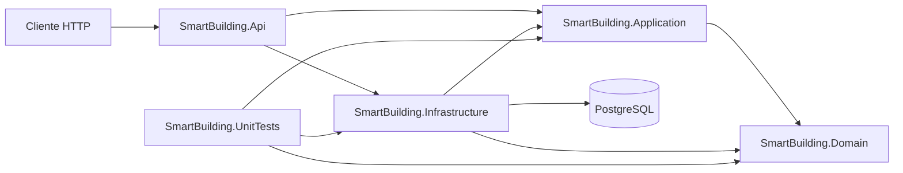

# Visão Geral da Arquitetura

## Objetivo

O Smart Building Access é uma plataforma para controlo de acessos e monitorização de ocupação. A arquitetura separa regras de negócio, orquestração, tecnologia de persistência e transporte HTTP para que cada parte possa evoluir e ser testada com menor acoplamento.

## Camadas atuais



As setas representam dependências de compilação ou uso. A camada apontada não conhece a camada de origem.

## Regra de dependência

As dependências devem apontar para o centro da aplicação:

```text
API ------------> Application ------------> Domain
  \                                      ^
   \-----------> Infrastructure ----------/
```

O Domain é o núcleo e não referencia nenhuma outra camada do sistema. Application conhece o Domain, mas não conhece API nem Infrastructure. Infrastructure conhece Domain e Application para mapear entidades e implementar contratos definidos pela Application. API funciona como composition root e conecta as partes.

## Responsabilidades

| Projeto | Responsabilidade principal | Estado |
|---|---|---|
| `SmartBuilding.Domain` | Vocabulário, estado e resultados do negócio | Entidades e resultados de Access Control implementados; sessões/alertas ainda sem processamento |
| `SmartBuilding.Application` | Casos de uso, DTOs, contratos e orquestração | CRUDs e decisão de Access Control com auditoria de eventos implementados |
| `SmartBuilding.Infrastructure` | EF Core, PostgreSQL e implementações técnicas | Persistência base e repositórios administrativos e de Access Control implementados |
| `SmartBuilding.Api` | Host HTTP, endpoints, autenticação e composição | Minimal APIs, validação, Problem Details, tokens JWT e autorização por policies implementados |
| `SmartBuilding.UnitTests` | Testes unitários, arquiteturais e de persistência | Inclui testes de `AccessControlService`, além dos testes dos CRUDs, hashing, validação HTTP de User e metadados |

## Fluxo atual

Além do endpoint de estado, os fluxos verticais implementados atravessam todas as camadas:

```text
HTTP /api/buildings
HTTP /api/floors
HTTP /api/access-points
HTTP /api/access/requests
HTTP /api/access/events
  -> requests e endpoints do recurso em SmartBuilding.Api
  -> serviço e contrato de repositório em SmartBuilding.Application
  -> repositório e SmartBuildingDbContext em SmartBuilding.Infrastructure
  -> PostgreSQL
```

Os fluxos implementam listagem, consulta por ID, criação, atualização e remoção de `Building`, `Floor` e `AccessPoint`. O delete de edifício retorna conflito quando há pisos associados. O delete de piso retorna conflito quando há pontos de acesso ou sessões de ocupação. O delete de ponto de acesso retorna conflito quando existem permissões, eventos ou alertas relacionados. As FKs também protegem contra dependências inseridas concorrentemente. Criação e atualização de pisos distinguem piso e edifício pai inexistentes; as operações de `AccessPoint` distinguem ponto e piso pai inexistentes.

Antes de servir endpoints, a API exige `ConnectionStrings:SmartBuilding`. Em `Development`, o bootstrap aplica migrations e executa o seed mínimo. O endpoint `GET /` continua sem acessar o banco, enquanto `/api/buildings`, `/api/floors` e `/api/access-points` usam a persistência PostgreSQL.

Os CRUDs administrativos de `Buildings`, `Floors`, `AccessPoints`, `Users`, `AccessCards` e `AccessPermissions` estão implementados. A decisão de acesso também está implementada: `POST /api/access/requests` avalia cartão, User, AccessPoint, direção e permissão, e grava um `AccessEvent` para cada pedido processado com AccessPoint conhecido. `GET /api/access/events` e `GET /api/access/events/{id}` consultam esse histórico. A permissão deve estar ativa e satisfazer `ValidFrom <= now < ValidUntil`, sendo `ValidUntil` opcional. O CRUD administrativo de `AccessPermission` e a sua avaliação em tempo de pedido são capacidades relacionadas, mas distintas.

O fluxo de decisão exige a policy `AccessOperations` (`Admin` ou `SecurityOperator`). Ainda não atualiza `OccupancySession`, não envia notificações SignalR nem processa alertas; esses comportamentos continuam planejados.

O CRUD administrativo de `Users` também está implementado em `/api/users` e protegido por `AdminOnly`. A validação HTTP verifica o email após remover whitespace externo, e a Application normaliza-o para lowercase antes de persistir; solicita hash da password na criação e as responses omitem password e hash. Users começam como `SecurityOperator`; um Admin pode atribuir papéis, sem rebaixar o último Admin. O login JWT e as policies estão implementados; consulte [Autenticação e autorização](authentication-authorization.md) para configuração segura, bootstrap e limites. A UI continua ausente.

## Fluxo implementado de uma solicitação de acesso

```mermaid
sequenceDiagram
    participant Reader as Leitor/Simulator
    participant Api as API
    participant App as Application
    participant Infra as Infrastructure
    participant Db as PostgreSQL

    Reader->>Api: POST /api/access/requests
    Api->>App: ExecuteAsync(request)
    App->>Infra: Consultar cartão, utilizador e permissão
    Infra->>Db: SELECT
    Db-->>Infra: Estado persistido
    Infra-->>App: Dados necessários
    App->>App: Avaliar condições na ordem definida
    App->>Infra: Persistir AccessEvent
    Infra->>Db: INSERT
    App-->>Api: AccessEvent DTO/result
    Api-->>Reader: HTTP 200 com decisão; 404 para AccessPoint desconhecido
```

Uma falha de validação de request resulta em `400` com Problem Details e não é
uma decisão de acesso. Um AccessPoint desconhecido resulta em `404`: a FK
obrigatória impede criar `AccessEvent` sem ponto válido. Para qualquer
resultado de decisão com ponto existente, o evento é persistido.

## Princípios arquiteturais

### Domínio independente

O Domain não pode depender de ASP.NET Core, EF Core, PostgreSQL, serialização, Docker ou detalhes de interface.

### Eventos brutos e estado derivado

`AccessEvent` representa um fato auditável. `OccupancySession` representa estado derivado desses eventos. Uma correção de ocupação não deve apagar ou reescrever o histórico bruto.

### Composition root na API

A API lê a connection string e chama `AddInfrastructure`, que registra `SmartBuildingDbContext` com Npgsql e convenção `snake_case`. Isso não significa que regras de negócio pertencem à API.

### Persistência como detalhe externo

EF Core traduz o modelo para PostgreSQL. Entidades do Domain não devem receber atributos ou comportamentos específicos do banco.

### Evolução por fases

Cada fase deve terminar com build, testes e um pull request focado. Tecnologias futuras não devem ser adicionadas antes de existir uma necessidade da fase atual.

## Estado por fase

| Fase | Estado resumido |
|---|---|
| Foundation | Concluída |
| Domain estrutural | Concluída pelo Definition of Done atual |
| Database | Persistência base implementada e validada |
| API funcional | CRUDs administrativos e rotas de decisão/eventos implementados nesta branch |
| Access Control | Decisão, auditoria, consultas de evento e autenticação/autorização JWT implementadas nesta branch; ocupação, SignalR e alertas seguem futuros |

PostgreSQL 18 foi executado num container descartável, na porta isolada `55432`, para validar a migration, o arranque, a idempotência do seed e os slices de `Buildings`, `Floors`, `AccessPoints` e `Users`. Para Users, o smoke confirmou email uppercase com espaços externos criado em `201` e canonicalizado para lowercase, duplicidade `409`, consulta `200`, atualização `200` e remoção `204`; também confirmou hash armazenado pelo `PasswordHasher<User>`, response sem password/hash, delete bloqueado por cartão com `409` e evento preservado com `UserId` nulo. Isso não significa que a fase futura de Docker da aplicação foi implementada.

Consulte [o plano do projeto](smart-building-project-plan.md) para todas as fases e critérios de conclusão.
